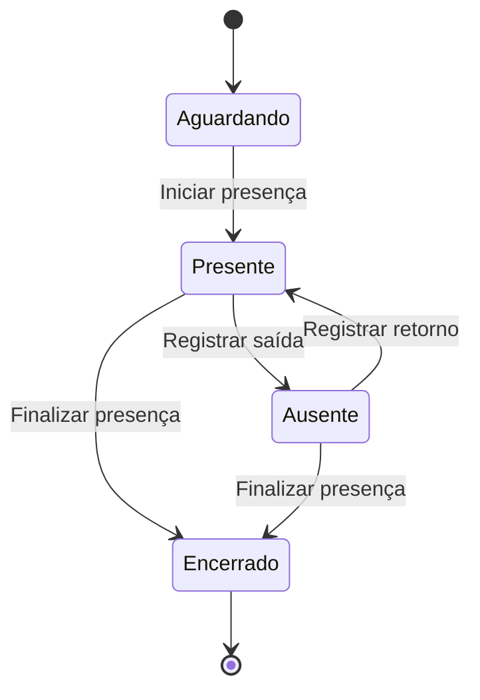
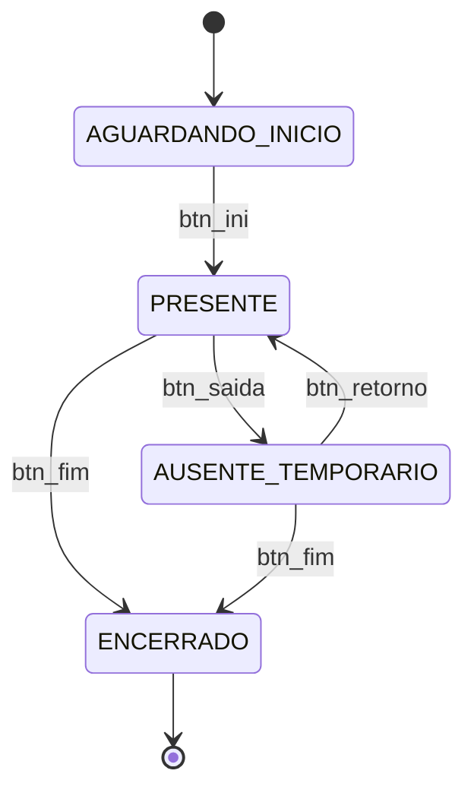

# festta

Fast student attendance.

<https://copilot.cloud.microsoft/chat/share/eyJzaGFyZUlkIjoiMGM1Mzk3NTktNGM4YS00ZGQ2LWJmNTUtYjM4NjZhODdhZDdiIiwiY29udmVyc2F0aW9uSWQiOiI1YmRkMzMwMC1iZDQ1LTQxNjYtYmIxNC0xODM3ZGZiNjI1ZGUifQ%3D%3D>

## Funcionalidades

1. Iniciar presença
2. Registrar saída
3. Registrar retorno
4. Finalizar presença

## Instalação

Abra o PowerShell ou o WindowsTerminal e execute:
- `irm https://raw.githubusercontent.com/jurandysoares/festta-tui/main/install.ps1 | iex`

## Máquina de estados finita


Versão texto:

```text
AGUARDANDO_INICIO
        |
        v
     PRESENTE
      /    \
     v      v
AUSENTE <-> PRESENTE
     |
     v
 ENCERRADO
```

Versão Mermaid simplificado:



Versão compatível com o código em Python:



Versão mais completa, listando quais botões estão habilitados ou desabilitados em cada estado:

```mermaid
stateDiagram-v2

    [*] --> AGUARDANDO_INICIO

    state AGUARDANDO_INICIO {
        note right of AGUARDANDO_INICIO
            Habilitado:
            - Iniciar presença

            Desabilitados:
            - Registrar saída
            - Registrar retorno
            - Finalizar presença
        end note
    }

    state PRESENTE {
        note right of PRESENTE
            Habilitados:
            - Registrar saída
            - Finalizar presença

            Desabilitados:
            - Iniciar presença
            - Registrar retorno
        end note
    }

    state AUSENTE_TEMPORARIO {
        note right of AUSENTE_TEMPORARIO
            Habilitados:
            - Registrar retorno
            - Finalizar presença

            Desabilitados:
            - Iniciar presença
            - Registrar saída
        end note
    }

    AGUARDANDO_INICIO --> PRESENTE : Iniciar presença
    PRESENTE --> AUSENTE_TEMPORARIO : Registrar saída
    AUSENTE_TEMPORARIO --> PRESENTE : Registrar retorno

    PRESENTE --> ENCERRADO : Finalizar presença
    AUSENTE_TEMPORARIO --> ENCERRADO : Finalizar presença

    ENCERRADO --> [*]
```

Tabela com estados e ação que provoca sua transição.

| Estado atual       | Ação               | Próximo estado     |
| ------------------ | ------------------ | ------------------ |
| AGUARDANDO_INICIO  | Iniciar presença   | PRESENTE           |
| PRESENTE           | Registrar saída    | AUSENTE_TEMPORARIO |
| AUSENTE_TEMPORARIO | Registrar retorno  | PRESENTE           |
| PRESENTE           | Finalizar presença | ENCERRADO          |
| AUSENTE_TEMPORARIO | Finalizar presença | ENCERRADO          |
| ENCERRADO          | Iniciar presença   | PRESENTE           |

